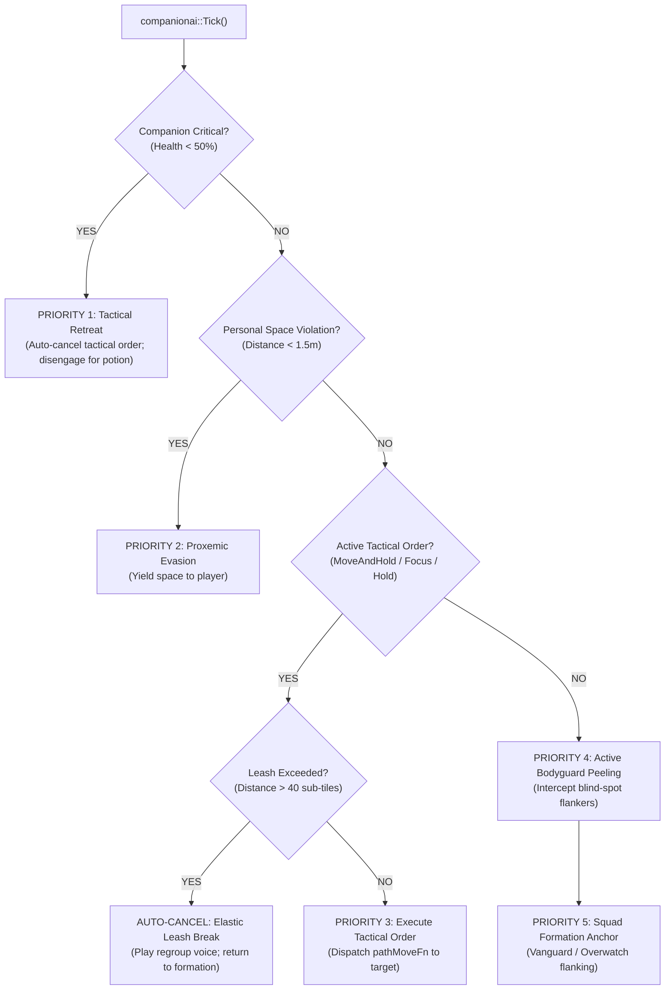

# VR Companion AI: Gesture-Based Tactical Commands (Point & Hold)

## 1. Overview & Motivation

In flat *Diablo II: Resurrected*, mercenaries are passive followers governed by a rigid, autonomous state machine. Players have no direct agency to instruct their hireling to scout ahead, hold a defensive chokepoint, or focus down a high-priority elite monster (such as an *Extra Fast / Lightning Enchanted* boss or a dangerous resurrection shaman).

In Virtual Reality (VR), your mercenary stands beside you as a physical, human-scale presence. Immersion and tactical depth demand that players can **communicate intent directly through natural VR gestures**:
- **Point-and-Command (Move & Hold):** Pointing your finger at a doorway, corridor, or ground location and squeezing the grip commands the mercenary to advance and secure that position.
- **Priority Target Marking (Focus Fire):** Pointing at a specific monster entity while clicking the grip commands the mercenary to prioritize that enemy over ambient threats.
- **Defensive Hold (Open-Palm Stance):** Raising a flat, upright palm towards your companion commands a temporary halt and defensive stance at their current position.

This document details the architectural integration of gesture-based tactical commands with the modernized VR Companion AI system ([`steamvr/companion_ai.h`](../steamvr/companion_ai.h) and [`vr/companion_ai.cpp`](../vr/companion_ai.cpp)), ensuring seamless coexistence with personal space proxemics, bodyguard peeling, emergency anti-stuck watchdogs, and tactical health retreats.

---

## 2. Priority Hierarchy & State Machine Integration

### Placement within the Tactical Coordinator
The companion coordinator in [`companionai::Tick`](../vr/companion_ai.cpp) evaluates movement intentions every frame. Tactical orders act as direct player directives, superseding ambient squad formation and autonomous blind-spot peeling, but strictly subordinating to **critical self-preservation** and **personal space safety**:



> [!IMPORTANT]
> **The Golden Survival Rule:** If the player orders a companion to hold a dangerous position or fight a deadly pack, but the companion's health drops below 50% (`CriticalHealthRatio = 0.50f`), **self-preservation immediately overrides the tactical order**. The order is auto-cancelled, the companion emits an urgent distress cry, and retreats to the player's forward arc in a receiving stance to await a healing potion. Players cannot force an AI companion into a suicidal death lock.

### Data Model (`TacticalOrder`)
In [`steamvr/companion_ai.h`](../steamvr/companion_ai.h):

```cpp
enum class TacticalOrderType : uint8_t {
    None = 0,         // Autonomous mode: standard formations and peeling
    MoveAndHold,      // March to target ground coordinate and hold defensive ground
    PrioritizeEnemy,  // Focus attack exclusively on a specific monster entity
    DefensiveHold     // Cease movement and lock current ground position
};

struct TacticalOrder {
    TacticalOrderType type = TacticalOrderType::None;
    uint32_t targetUnitId = 0;       // Unit ID if type == PrioritizeEnemy
    Vec2 targetPos{};                // Sub-tile world coordinates
    uintptr_t targetRoom = 0;        // D2RoomStrc pointer
    uint64_t issuedMs = 0;           // Timestamp of command issuance
    uint64_t holdDurationMs = 0;     // 0 = indefinite until leash break or cancel
};
```

---

## 3. Gesture Recognition & Kinematics

### Gesto 1: Point-to-Command (*Raycast + Grip Click*)
* **Aim Vector Extraction:** Derived from the OpenXR aim pose of the commanding hand (`handAim[h]` from `/user/hand/.../input/aim/pose`):
  $$\mathbf{P}_{\text{origin}} = \mathbf{P}_{\text{aim}}, \quad \mathbf{D}_{\text{aim}} = \mathbf{Rotate}(\mathbf{Q}_{\text{aim}}, \{0, 0, -1\})$$
* **Entity Intersection (Target Marking):**
  * Evaluated via [`targetcone::Pick`](../steamvr/target_cone.h): checks ray against nearby `melee::Hostiles`.
  * If a hostile monster lies within an angular tolerance ($\le 12^\circ$), it is designated as `PrioritizeEnemy`. Friendly/neutral NPCs (`AlignOffset == 1`) are explicitly filtered out.
* **Ground Intersection (Move & Hold):**
  * If no monster is targeted, [`spellaim::GroundPoint`](../steamvr/spell_aim.h) intersects the aim ray with the floor elevation plane ($Y = \text{floorY}$).
  * Resolves room membership via `roomPointFn(playerRoom, targetX, targetY)`.
  * If walkable, registers as `MoveAndHold`.
* **Execution Trigger:** Flank rise of the controller grip squeeze (`in.grip[h] > 0.6f && !gripWas[h]`).
  * **Input Conflict Filter:** Squeezing the grip is ignored if the hand is within belt or holster interaction distance (`interactionOutput.nearBelt >= 0 || interactionOutput.nearHolster >= 0`) to prevent accidental commands while pulling potions or drawing weapons.

### Gesto 2: Open-Palm Defensive Hold (*Upright Palm towards Companion*)
* **Kinematic Detection Formula:**
  1. **Upright Hand Orientation:** Hand upward axis aligned with room upward vector:
     $$\mathbf{Up}_{\text{hand}} \cdot \mathbf{Up}_{\text{room}} > \cos(35^\circ) \approx 0.82$$
  2. **Palm Directed at Companion:** Palm outward normal ($\mathbf{N}_{\text{palm}}$) points directly toward the companion's current position:
     $$\mathbf{N}_{\text{palm}} \cdot \frac{\mathbf{P}_{\text{comp}} - \mathbf{P}_{\text{hand}}}{\|\mathbf{P}_{\text{comp}} - \mathbf{P}_{\text{hand}}\|} > 0.70$$
  3. **Open / Relaxed Hand:** Neither grip nor trigger is engaged (`grip < 0.2f && trigger < 0.2f`).
* **Temporal Hysteresis:** The open-palm posture must be sustained for **400 ms** to eliminate accidental triggers during natural hand movements.
* **Effect:** Issues `DefensiveHold`, freezing companion movement at their current coordinates, accompanied by a subtle haptic pulse in the commanding controller.

---

## 4. Voice Line & Audio Architecture

When mercenaries lack dedicated command voice recordings, D2R-PCVR borrows canonical hero voice files matching each hireling class archetype.

### Archetype Voice Fallback Mapping
Audio files reside in `data:locales\audio\<locale>\data\local\sfx\common` (e.g. `data:locales\audio\eses\data\local\sfx\common` for Spanish, `enus` for English), and are referenced via native `sounds.txt` row IDs:

| Hireling Class | Class ID | Archetype | Canonical Voice Fallback | Engine Sound Prefix |
| :--- | :--- | :--- | :--- | :--- |
| **Act 1 Rogue Scout** | `271` | Ranged Overwatch | **Amazon** | `amazon_chat_*` / `amazon_*` |
| **Act 2 Desert Guard** | `338` | Melee Vanguard | **Paladin** | `paladin_chat_*` / `paladin_*` |
| **Act 3 Iron Wolf** | `359` | Elemental Overwatch | **Necromancer** | `necromancer_chat_*` / `necromancer_*` |
| **Act 5 Barbarian** | `560`, `561` | Melee Vanguard | **Barbarian** | `barbarian_chat_*` / `barbarian_*` |

### Contextual Voice Lines

```
                           +-------------------------------+
                           |      PLAYER GESTURE/ORDER     |
                           +-------------------------------+
                                           |
                   +-----------------------+-----------------------+
                   |                                               |
         [Valid Order Issued]                            [Invalid / Impossible]
                   |                                               |
         +---------+---------+                       "x_impossible" ("Impossible / No")
         |                   |                       - Out of range / Unwalkable path
   [Move & Hold]      [Attack Target]                - Blocked doorway / Chasm
         |                   |                       - Leash distance exceeded (> 40)
  "x_follow_me"        "x_attack"
 ("On my way")       ("Attacking!")
```

1. **Order Rejection (`x_impossible`):**
   * Played immediately if the player commands an action that cannot be fulfilled (e.g. clicking unnavigable terrain like lava or chasms, aiming beyond `ElasticCombatLeashDistance`, or commanding an action while the companion is in critical health retreat).
   * Voice line: *"Impossible"*, *"I can't do that"*, *"No"*.
2. **Move Confirmation (`x_follow_me` / `x_yes`):**
   * Played upon issuing a valid `MoveAndHold` command.
   * Voice line: *"Understood"*, *"On my way"*, *"Moving"*.
3. **Target Prioritization (`x_attack` / Battle Cry):**
   * Played when an elite or hostile monster is marked as `PrioritizeEnemy`.
   * Voice line: *"Target acquired"*, *"For the cause!"*, or class combat shout.
4. **Defensive Hold (`x_wait_here`):**
   * Played when the open-palm hold gesture locks the companion's stance.
   * Voice line: *"Holding ground"*, *"Standing firm"*.
5. **Leash Break / Regrouping (`x_regroup` / `x_follow_me`):**
   * Played when the player moves past the leash limit, forcing the companion to abandon their hold position and catch up to the player's formation.
   * Voice line: *"Regrouping!"*, *"Coming with you!"*.
6. **Critical Health Distress (`x_help`):**
   * Automatically triggered when life drops below 50%, overriding any active hold order (already implemented via `GetArchetypeDistressSound`).

---

## 5. Visual Feedback: Tactical Command Beacon & Decals

To provide unambiguous spatial feedback in VR, an active tactical command renders a holographic world-space beacon and ground decal at the target location:

```
          Beacon Column
        [Vertical Beam]       <--- Translucent energy column (height: 2.5m, radius: 0.25m)
              ||
              ||
             ====             <--- Ground Decal (Pulsing concentric ring, radius: 0.8m)
          [Ground]
```

### Visual Specifications
* **Shader Pipeline:** Rendered through the GPU particle pipeline in [`steamvr/elemental_hands_renderer.cpp`](../steamvr/elemental_hands_renderer.cpp) or a dedicated world-space decal pass with additive alpha blending and depth testing.
* **Color Coding:**
  * **Cyan / Neon Blue (`#00E5FF`):** `MoveAndHold` — Indicates a secure defensive move position.
  * **Crimson / Fire Orange (`#FF3D00`):** `PrioritizeEnemy` — Projected as an overhead chevron and ground reticle highlighting the marked monster.
  * **Amber / Gold (`#FFC107`):** `DefensiveHold` — Renders as an expanding-and-contracting ground ring around the companion's feet.
* **Duration & Fading:**
  * Beacons persist as long as the command is active.
  * When a command completes or auto-cancels, the beacon smoothly fades out over 0.5 seconds.
  * If a command is rejected (`x_impossible`), the decal flashes red twice and dissolves.

---

## 6. Edge Cases & Safety Guarantees

| Edge Case | Failure Mode | Architectural Solution |
| :--- | :--- | :--- |
| **Player Leaves Area / Runs Away** | Companion remains permanently pinned at hold position in another room while player dies without support. | **Elastic Leash Auto-Cancel:** If the distance between player and companion (or target position) exceeds `ElasticCombatLeashDistance` (40 sub-tiles / ~16 m), the tactical order automatically terminates. Companion plays regroup voice line and resumes formation follow. |
| **Target Monster Dies or Despawns** | Companion freezes attempting to pathfind to a destroyed or null unit entity. | Active target validity is verified on every tick. When the marked monster dies, the order automatically transitions into `MoveAndHold` at the monster's death coordinate for 2.0 s, then smoothly reverts to autonomous formation. |
| **Unwalkable / Invalid Navmesh Point** | Player points at a chasm, lava, wall, or off-map void. | Evaluated via `roomPointFn`. If the target coordinate is non-traversable, the command is immediately rejected: plays `x_impossible` voice line and flashes red rejection beacon. |
| **Critical Health Danger (< 50% HP)** | Player holds companion inside an elite mob pack, resulting in companion death. | `TacticalRetreatController` holds supreme priority. When HP < 50%, tactical order is immediately aborted; companion cries for help and retreats to the player's front arc for potion tossing. |
| **Level Transitions & Portals** | Companion retains obsolete target coordinates from a previous dungeon floor. | Level transitions, town portals, or `playerRoom` epoch changes automatically reset `TacticalOrder` to `None`. |
| **Input Clashes (Potions & Holsters)** | Squeezing grip to draw a belt potion accidentally dispatches an unwanted move command. | Strict mutual exclusion: grip input is rejected if `interactionOutput.nearBelt >= 0` or `interactionOutput.nearHolster >= 0`. |
| **Targeting Friendly / Neutral Units** | Player points at Deckard Cain, Charsi, or the companion itself. | Entity picking filters `AlignOffset != 1`. Pointing at the companion itself and clicking grip is interpreted as an explicit **"Regroup"** command. |

---

## 7. Implementation Roadmap

### Phase 1: Core Tactical State Machine ([`steamvr/companion_ai.h`](../steamvr/companion_ai.h))
- Implement `TacticalOrderType` and `TacticalOrderController`.
- Implement `IssueOrder()`, `CancelOrder()`, leash-break auto-cancel, and health override checks.
- Add comprehensive automated unit tests in [`steamvr/companion_ai_test.cpp`](../steamvr/companion_ai_test.cpp).

### Phase 2: Engine Movement Dispatcher ([`vr/companion_ai.cpp`](../vr/companion_ai.cpp))
- Integrate tactical order execution into `companionai::Tick`.
- Connect `MoveAndHold` and `PrioritizeEnemy` to native `pathMoveFn(compPath, hireling, targetRoom, targetX, targetY)` at RVA `0x381890`.
- Integrate audio voice line triggers (`x_impossible`, affirmations, hold calls) via `threads->runOnUiThread`.

### Phase 3: Gestures & Kinematic Input ([`steamvr/transport.cpp`](../steamvr/transport.cpp))
- Bind `handAim` raycast against `melee::Hostiles` and `spellaim::GroundPoint`.
- Implement open-palm hold orientation filter (upright vector dot product $> 0.82$, palm normal to companion $> 0.70$, 400 ms hold timer).
- Wire grip press with belt/holster exclusion guards.

### Phase 4: Visual Holographic Beacon & Decals
- Add command beacon cylinder and ground ring rendering.
- Wire color states (Cyan for move, Red for focus, Gold for hold).

### Phase 5: In-Headset Calibration & Verification
- Test in Meta Quest 3 across Act 1 Catacombs and Blood Moor.
- Validate audio responsiveness and leash auto-cancels.

