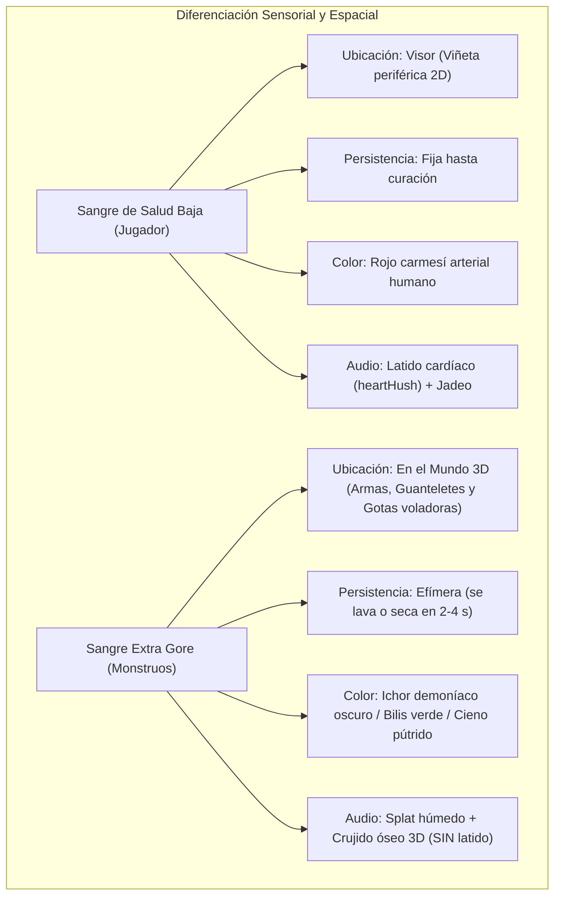

# Especificación Técnica y Plan de Implementación: Modo Extra Gore en VR

**Proyecto:** Diablo II: Resurrected VR Unleashed (`d2r-pcvr`)  
**Documento:** `docs/es/MODO_EXTRA_GORE_VR.md`  
**Estado:** Especificación de Diseño y Plan de Implementación  
**Fecha:** Octubre 2026  
**Rama propuesta:** `feat/extra-gore-vr`  

---

## 1. Resumen Ejecutivo y Factibilidad Técnica

### Veredicto: 100% Factible
La implementación de un sistema de **Extra Gore para Realidad Virtual** en Diablo II: Resurrected es completamente viable sin modificar archivos de guardado (`.d2s`), sin alterar las tablas maestras de datos ni violar la compatibilidad con el juego en monitor de escritorio.

El sistema se apoya en 4 pilares de ingeniería inversa ya operativos en `d2r-pcvr`:
1. **Intercepción de combate y ciclo de daño:** Hooks en `ApplyDamage` (RVA `0x44CE80`) y `SetStat` (RVA `0x44D08F`, stat 6 HP) en [`vr/combat.cpp`](file:///c:/Users/Player%201/Desktop/d2r-pcvr/vr/combat.cpp).
2. **Manipulación esquelética en tiempo real (Granny 3D):** Hook en `SkeletonInstance::ComputeSelfWorldPose` (RVA `0xF78740`) en [`vr/skeletons.cpp`](file:///c:/Users/Player%201/Desktop/d2r-pcvr/vr/skeletons.cpp).
3. **Pipeline de partículas 3D en Direct3D 12:** Arquitectura de renderizado de quads con shaders GPU probada en [`steamvr/elemental_hands_renderer.cpp`](file:///c:/Users/Player%201/Desktop/d2r-pcvr/steamvr/elemental_hands_renderer.cpp).
4. **Motor háptico multicanal y audio espacial FMOD:** [`steamvr/haptic_pulse.h`](file:///c:/Users/Player%201/Desktop/d2r-pcvr/steamvr/haptic_pulse.h) y [`vr/spatial_audio.cpp`](file:///c:/Users/Player%201/Desktop/d2r-pcvr/vr/spatial_audio.cpp).

---

## 2. Resolución del Conflicto UX: Sangre en Visor vs Indicador de Vida Baja

### El Problema de Diseño
En `d2r-pcvr`, [`steamvr/blood_screen.h`](file:///c:/Users/Player%201/Desktop/d2r-pcvr/steamvr/blood_screen.h) utiliza salpicaduras periféricas en el visor como indicador de salud crítica (<60%, <40%, <20% HP). Si la sangre de los monstruos se estampa en el visor con la misma apariencia, el jugador experimentará **falsos positivos de daño**, provocando confusión táctica y pánico injustificado.

### La Solución Arquitectónica Cuádruple



1. **Prioridad "In-World" (En el Mundo 3D):**
   - El gore principal se proyecta sobre **la hoja de las armas**, los **guanteletes del héroe** y en forma de **gotas volumétricas que vuelan por el espacio tridimensional** con profundidad estereoscópica.
   - Las lentes del visor se mantienen libres de falsos positivos de vida por defecto.
2. **Diferenciación Cromática de *Ichor* Demoníaco:**
   - La sangre del héroe es roja brillante.
   - La sangre enemiga varía según la taxonomía demoníaca:
     - **Demonios:** *Ichor* negro-brea coagulado.
     - **No-muertos:** Polvo de huesos y cieno grisáceo-marrón.
     - **Insectos y Bestias:** Bilis amarilla-verdosa ácida.
3. **Comportamiento Efímero vs Permanente:**
   - Si el usuario activa salpicaduras hostiles en el visor, estas son gotas perdigonadas dispersas tipo parabrisas que **se desvanecen automáticamente en 2.5 segundos** (frente a la viñeta permanente de vida baja).
4. **Desacoplamiento Auditivo y Háptico:**
   - La sangre de vida baja siempre va acompañada del bucle de latido cardíaco ([`heartHush`](file:///c:/Users/Player%201/Desktop/d2r-pcvr/steamvr/transport.cpp#L2486)).
   - El gore enemigo solo reproduce el impacto húmedo (*squelch*) en la coordenada espacial del golpe, sin latido ni jadeos.

---

## 3. Arquitectura de Datos y Memoria Compartida (IPC)

Para transferir los eventos de gore desde el proceso del juego (`vr/` / `d2rl-pcvr.dll`) hacia el runtime OpenXR (`steamvr/`) sin bloquear el hilo principal a 25 Hz de D2R ni el hilo de renderizado a 90/120 Hz de OpenXR, se define un búfer circular en [`shared/d2r_vr_shared.h`](file:///c:/Users/Player%201/Desktop/d2r-pcvr/shared/d2r_vr_shared.h):

```cpp
#define D2RVR_GORE_MAGIC 0x474F5245u // "GORE"

enum class GoreType : uint8_t {
    SlashDecapitation = 0, // Corte letal con arma afilada (cabeza cercenada)
    BluntBoneCrush    = 1, // Aplastamiento contundente (cráneo / torso roto)
    PiercingArterial  = 2, // Perforación profunda (chorro arterial)
    CorpseExplosion   = 3, // Detonación de cadáver del Nigromante
    FrostShatter      = 4, // Quiebre de enemigo congelado
    PoisonAcidBurst   = 5  // Explosión de bilis ácida
};

enum class BloodTaxonomy : uint8_t {
    DemonDarkIchor = 0, // Negro/rojizo oscuro
    UndeadRotten   = 1, // Gris/amarillento pútrido
    BeastCrimson   = 2, // Rojo vivo
    InsectAcidBile = 3  // Verde ácido
};

#pragma pack(push, 1)
struct D2RVR_GoreEvent {
    uint32_t timestamp;        // Reloj D2RVRStampNow()
    uint32_t monsterEntityId;  // ID de la entidad en D2R ECS
    GoreType type;             // Categoría de violencia
    BloodTaxonomy taxonomy;    // Color de la sangre
    uint8_t  strikingHand;     // 0 = Mano derecha, 1 = Mano izquierda
    uint8_t  severity;         // 0..255 (intensidad de daño o crítico)
    float    worldPos[3];      // Coordenadas 3D del impacto en unidades de juego
    float    impactNormal[3];  // Vector director de la inercia del golpe
};

struct D2RVR_GoreQueue {
    uint32_t magic;            // D2RVR_GORE_MAGIC
    uint32_t head;             // Índice de escritura (vr/)
    uint32_t tail;             // Índice de lectura (steamvr/)
    D2RVR_GoreEvent events[16];// Búfer circular lock-free
};
#pragma pack(pop)
```

---

## 4. Detalles de Implementación de los Subsistemas

### 4.1. Decapitación Esquelética en Granny 3D y Corte Limpio de Cuello (`vr/skeletons.cpp` / `shared/d2r_vr_decapitation.h`)
- **Hook en tiempo real:** `SkeletonInstance::ComputeSelfWorldPose` (RVA `0xF78740`).
- **Arquitectura de Malla Continua en D2R (Por qué Corte Limpio Siempre):**
  - Los modelos 3D de monstruos en D2R son mallas orgánicas continuas unificadas con *smooth skinning* compartido entre `neck_M_JNT` y `head_M_JNT`.
  - Desplazar en traslación el hueso de la cabeza genera estiramiento poligonal elástico (*rubber-banding*) en la piel del cuello, produciendo deformaciones anómalas.
  - La solución óptima y definitiva es **ejecutar siempre un corte limpio en el muñón (`CollapseHeadBones`)**: el hueso de la cabeza y todos sus descendientes jerárquicos (mandíbula, cuernos, pelo, etc.) se colapsan a escala $0.0001f$ anclándose exactamente en las coordenadas del pivote del cuello (`neck_M_JNT`). Esto elimina por completo cualquier estiramiento o deformación, dejando un cadáver decapitado limpio, estéticamente impecable y auténtico.
- **Lógica de Decapitación Circunstancial (No 100% Ubicua):**
  - Se evita que todo enemigo resulte decapitado siempre de forma monótona o irreal.
  - La probabilidad y condición de corte se calcula en `vr/combat.cpp` en función del daño infligido y la configuración del usuario:
    - **Modo 0 (Off):** Decapitación desactivada; los monstruos siempre conservan su cabeza.
    - **Modo 1 (Crits Only):** Exclusivamente en golpes críticos (riposte letal, factor multiplicador de daño melee $\ge 1.5$, o daño excesivo *overkill* que supere el $150\%$ de la vida restante del monstruo).
    - **Modo 2 (Dynamic 35%):** Garantizado en críticos/riposte/overkill, y con un $35\%$ de probabilidad en cortes letales estándar con armas afiladas (Recomendado).
    - **Modo 3 (High 65%):** Garantizado en críticos/riposte/overkill, y con un $65\%$ de probabilidad en cortes letales estándar.
    - **Modo 4 (Always 100%):** Todo golpe mortal con arma cortante cercena limpiamente la cabeza.
- **Monstruos cualificados:** Inicialmente humanoides bípedos con jerarquía esquelética estándar:
  - Caídos / Chamanes (`Fallen`, `FallenShaman`).
  - Zombis / Demonios famélicos (`Zombie`, `HungryDead`).
  - Esqueletos (`Skeleton`, `SkeletonArcher`).
  - Pícaras corruptas (`CorruptRogue`).

### 4.2. Sangre y Goteo en Armas (`steamvr/torch_light.h` / `weapon_blood.h`)
- Basado en el modelo matemático de la punta de la antorcha (`ComputeTorchTip` en [`steamvr/torch_light.h`](file:///c:/Users/Player%201/Desktop/d2r-pcvr/steamvr/torch_light.h)):
  $$\mathbf{P}_{\text{filo}} = \mathbf{P}_{\text{mando}} + \mathbf{R}_{\text{mando}} \cdot \mathbf{Offset}_{\text{arma}}$$
- Se introduce un acumulador `bloodBuildup` ($[0.0, 1.0]$) por cada mano:
  - Cada impacto cuerpo a cuerpo letal añade $+0.35$ de sangre.
  - La sangre se limpia pasivamente por escurrimiento ($dt \cdot -0.05/\text{s}$) o mediante sacudida rápida del mando ($\text{aceleración} > 4.5\text{ m/s}^2$).
  - Si `bloodBuildup > 0.2`, la punta del arma genera gotas de sangre 3D que caen verticalmente por gravedad hacia el suelo.

### 4.3. Surtidores Arteriales 3D en Direct3D 12 (`steamvr/gore_renderer.cpp`)
- Reutiliza la infraestructura de creación de Command Lists y Root Signatures de [`steamvr/elemental_hands_renderer.cpp`](file:///c:/Users/Player%201/Desktop/d2r-pcvr/steamvr/elemental_hands_renderer.cpp).
- Un emisor de partículas genera un abanico cónico de quads orientados a cámara desde el cuello decapitado:
  $$\mathbf{P}(t) = \mathbf{P}_0 + \mathbf{v}_0 t + \frac{1}{2} \mathbf{g} t^2$$
  donde $\mathbf{v}_0$ es un vector ascendente aleatorio dentro de un cono de $35^\circ$ con velocidad inicial de $1.2\text{ a }2.5\text{ m/s}$, y $\mathbf{g} = (0, -9.8, 0)\text{ m/s}^2$.
- Decaimiento de opacidad alfa y contracción de tamaño a lo largo de $1.5\text{ s}$.

### 4.4. Hápticos Viscerales Diferenciados (`steamvr/haptic_pulse.h`)
- En [`steamvr/haptic_pulse.h`](file:///c:/Users/Player%201/Desktop/d2r-pcvr/steamvr/haptic_pulse.h), se implementan patrones según la anatomía destruida:
  - **Corte de Carne / Decapitación:** Pulso seco a $160\text{ Hz}$ de $25\text{ ms}$, seguido de una meseta de fricción de $35\text{ ms}$ al $40\%$ de amplitud.
  - **Aplastamiento Óseo (Mazas/Martillos):** Pulso de onda cuadrada a $50\text{ Hz}$ de $85\text{ ms}$ con amplitud máxima ($1.0$), produciendo una sacudida densa en la mano.
  - **Onda Expansiva de Corpse Explosion:** Ráfaga estéreo sincronizada en ambas manos con envolvente exponencial decreciente de $180\text{ ms}$.

---

## 5. Plan de Implementación por Fases (Roadmap)


### Fase 1: Capa de Detección, IPC y Retroalimentación Sensorial [COMPLETADA - Commit aa6e2c8]
*Objetivo: Sentir el impacto visceral inmediatamente en las manos y oídos sin tocar aún los gráficos.*
1. **Detección de combate:** Extender `ApplyDamage` y `SetStat` en `vr/combat.cpp` para identificar golpes mortales, tipo de arma y distancia euclídea al jugador.
2. **Buffer IPC:** Incorporar `D2RVR_GoreQueue` en `shared/d2r_vr_shared.h`.
3. **Hápticos:** Implementar en `steamvr/haptic_pulse.h` los perfiles hápticos para corte óseo y carne.
4. **Audio 3D:** Conectar FMOD en `vr/spatial_audio.cpp` para reproducir sonidos de rotura y desgarro situados en la posición tridimensional del monstruo.
5. **Verificación automatizada:** Crear el test nativo `gore-events-test` en `steamvr/CMakeLists.txt` (Superado 100%).

### Fase 2: Decapitación Esquelética Granny 3D y Prop Físico de Cabeza [COMPLETADA]
*Objetivo: Ver cabezas rodar o desaparecer físicamente de los monstruos en combate cuerpo a cuerpo.*
1. **Detección de rigs y jerarquías:** Implementado en `shared/d2r_vr_decapitation.h` con resolución prioritaria de huesos de cabeza (`head_M_JNT`, `head_bind_jnt`, `Bip01 Head`, `head`) y cuello (`neck_M_JNT`, `neck_bind_jnt`, `Bip01 Neck`, `neck`) para Caídos, Zombis, Esqueletos, Pícaras y Bestias.
2. **Propagación y colapso óseo:** Construcción de máscara de descendientes $O(N)$ y colapso en escala $0.0001f$ anclando la posición tridimensional exactamente al pivote del cuello (`CollapseHeadBones`).
3. **Simulador balístico 3D de cabeza cercenada:** `SimulateHeadPhysics` con parábola gravitatoria, rebotes inelásticos contra el plano de suelo del monstruo ($e=0.35$), fricción horizontal ($\mu=2.5$) y rotación de volteo (*tumble*) en tiempo real.
4. **Decapitación circunstancial:** Integrada en `vr/combat.cpp` basada en tipo de daño (armas cortantes), daño excesivo (*overkill* $>150\%$), golpes críticos o riposte mortal, y probabilidad graduable.
5. **Hook de transformación en runtime:** Integrado en `vr/skeletons.cpp` dentro de `Hook` (`ComputeSelfWorldPose`) vinculando eventos `SlashDecapitation` de la cola IPC con instancias de esqueletos en espacio de juego vía ECS (`CandidatePosition`), alimentando las físicas con el nivel de suelo y la normal de impacto.
6. **Ciclo de vida y TTL:** Gestión thread-safe con `DecapitationManager` (TTL de 60 s para respetar animación de muerte y persistencia de cadáver).
7. **Verificación automatizada:** Test nativo `granny-decapitation-test` en `steamvr/CMakeLists.txt` con 7 suites completas pasando (144/144 tests globales pasando).

### Fase 3: Integración en Menú de Ajustes VR (`VR Settings > Combat`) [COMPLETADA]
*Objetivo: Permitir al usuario calibrar la frecuencia de decapitación directamente desde el visor en tiempo de ejecución de forma clara e intuitiva.*
1. **Control Unificado en `Page::Combat` (Fila 8):**
   - **`Decapitations`**: Selector escalonado con botones `[-]` y `[+]`:
     - `Off`: Decapitaciones desactivadas.
     - `Crits only`: Solo golpes críticos, riposte letal y daño masivo overkill (>150% HP).
     - `Dynamic (35%)`: Garantizado en críticos/overkill y 35% en cortes estándar (Recomendado).
     - `High (65%)`: Garantizado en críticos/overkill y 65% en cortes estándar.
     - `Always (100%)`: En el 100% de los golpes letales con armas cortantes.
2. **Optimización de UI y Distribución:**
   - Se unificó la configuración eliminando sub-opciones complejas o emparejamientos propensos a confusión en una única fila dedicada y siempre visible (9 filas totales en `Page::Combat`), encajando perfectamente con margen holgado sobre la zona de dificultad y el pie de página.
   - Decapitación siempre ejecutada como corte limpio en muñón (`Clean Stump`), evitando estiramientos de malla.
3. **Persistencia en `d2r_pcvr.ini`:**
   - Clave `[gore] decapitation=2` sincronizada en el repositorio y en los árboles de mod instalados (`mods/D2R-PCVR` y `mods/pcvr-dev`).
4. **Verificación automatizada:** Test nativo `vr-settings-test` (144/144 tests superados).

### Fase 4: Sangre en el Mundo VR (Armas Ensangrentadas y Goteo)
*Objetivo: Trasladar el gore a la perspectiva en primera persona sin ensuciar la visión vital del visor.*
1. **Tracking de filo:** Implementar `weapon_blood.h` con el cálculo de la posición de la hoja de espadas, hachas y mazas.
2. **Acumulación y secado:** Simular el manchado gradual de la hoja y el secado por inercia o sacudida.
3. **Goteo físico:** Gotas de sangre que emergen de la punta y caen hacia el suelo.
4. **Verificación automatizada:** Test unitario `weapon-blood-test`.

### Fase 5: Surtidores Arteriales 3D en Direct3D 12
*Objetivo: Erupción volumétrica de sangre tridimensional con física balística.*
1. **Pipeline D3D12:** Adaptar `elemental_hands_renderer.cpp` para crear `gore_renderer.cpp` con pipeline state object (PSO) de partículas rojas/oscuras.
2. **Física de partículas:** Simulación de gravedad, dispersión cónica y atenuación de opacidad.
3. **Verificación visual:** Vista previa mediante `interaction-preview.exe` o test `blood-particles-render-test`.

### Fase 6: Overkill Extremo y Corpse Explosion
*Objetivo: Culminación del sistema con soporte para hechizos brutales.*
1. **Corpse Explosion masiva:** Activación del efecto con la habilidad `CorpsExp` si el jugador está a $<4\text{ m}$.
2. **Gore elemental:** Quiebre de hielo para muertes por frío y bilis verde para muertes por veneno.
3. **Verificación completa:** Suite de pruebas CTest (144/144 tests pasando) y pruebas en visor Quest 3 / Steam Frame.

---

## 6. Configuración en `d2r_pcvr.ini`

```ini
[gore]
; Decapitations and hostile extra gore effects in VR (VR Settings > Combat > Decapitations)
; decapitation: 0 = Off, 1 = Crits only, 2 = Dynamic (35%), 3 = High (65%), 4 = Always (100%)
; Always executed as a clean cut at the neck stump with zero mesh deformation.
decapitation=2
```
