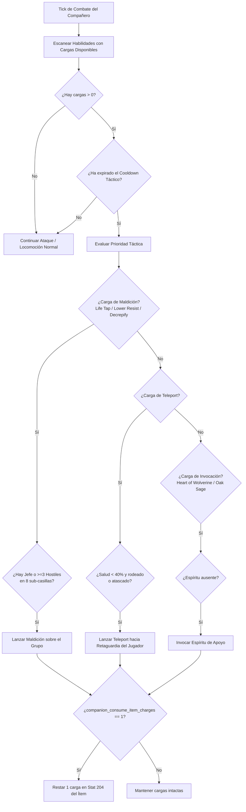
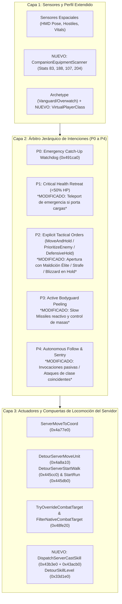
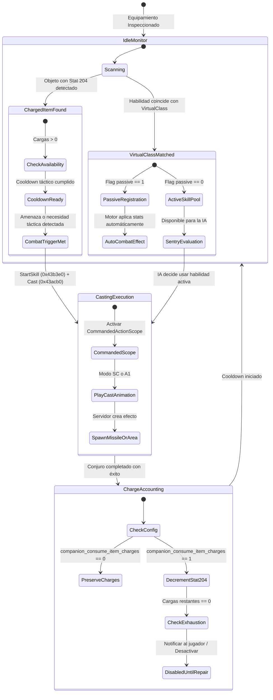

# IA de Compañero en VR: Clases Virtuales, Habilidades de Clase Coincidentes y Uso de Cargas de Objetos

> English: [docs/VR_COMPANION_CLASSES_AND_CHARGES.md](../VR_COMPANION_CLASSES_AND_CHARGES.md) | Referencias del Sistema de Compañeros: [docs/es/VR_COMPANION_AI.md](VR_COMPANION_AI.md) | Órdenes Tácticas: [docs/es/VR_COMPANION_TACTICAL_COMMANDS.md](VR_COMPANION_TACTICAL_COMMANDS.md)

---

## 1. Visión General y Motivación

En *Diablo II: Resurrected*, los mercenarios (compañeros contratados) adolecen de severas limitaciones técnicas heredadas del diseño original del año 2000:
1. **Aislamiento de Clase:** Internamente son entidades de tipo monstruo (`dwType == 1`, `UNIT_MONSTER`) y carecen de una clase de jugador asignada (`pPlayerData == nullptr`). Como consecuencia, no se benefician de bonificadores específicos de clase en objetos (por ejemplo, `+2 a habilidades de Amazona` en un arco equipado por una Pícara, o `+3 a habilidades de Hechicera` en una espada/escudo equipado por un Lobo de Hierro) ni pueden aprender ni ejecutar habilidades de clase procedentes de *staffmods* u *oskills*.
2. **Incapacidad Absoluta para Usar Cargas:** Aunque un mercenario lleve equipado un objeto con habilidades cargadas (por ejemplo, un bastón o tiara con cargas de *Teleport*, varitas con *Life Tap* o *Lower Resist*, o anillos con *Heart of Wolverine*), la IA nativa del juego (`AITHINK_Fn061_Hireable` en RVA `0x5c1610`) es 100% ciega a las cargas. Jamás las evalúa ni las lanza.

En Realidad Virtual (VR), donde el compañero es una presencia física interactiva a escala 1:1 que combate codo con codo con el jugador, estas restricciones merman drásticamente la profundidad táctica y la personalización del equipo.

Esta especificación detalla la arquitectura completa para:
* **Asignar clases de forma virtual en memoria** a cada mercenario sin alterar tablas de datos (`.txt`), permitiendo que el compañero desbloquee y potencie habilidades pasivas y activas que coincidan con su arquetipo.
* **Dotar a la IA del compañero de la capacidad de usar cargas de objetos equipados**, tanto de forma autónoma con criterio táctico como configurable mediante directiva de consumo de cargas (`consume_charges = 0 | 1`).
* **Integrar armónicamente estas capacidades dentro de la Arquitectura Unificada de IA de 3 Capas** descrita en [`docs/VR_COMPANION_AI.md`](../VR_COMPANION_AI.md) y en el sistema de órdenes tácticas por gestos de [`docs/VR_COMPANION_TACTICAL_COMMANDS.md`](../VR_COMPANION_TACTICAL_COMMANDS.md).

---

## 2. Reglas de Oro del Proyecto y Principio "Zero Data Table Mutation"

Siguiendo las directrices estrictas de arquitectura y colaboración de `d2r-pcvr`:
1. **Sin modificación de archivos `.txt` ni datos de tablas:** No se tocan ni redistribuyen `hireling.txt`, `skills.txt`, `itemstatcost.txt` ni `monstats.txt`. Toda la lógica se implementa dinámicamente en tiempo de ejecución mediante lectura de estructuras nativas e interceptores de bajo nivel.
2. **Cero corrupción de archivos de guardado (`.d2s`):** No se alteran las estructuras persistidas en disco del personaje ni del mercenario. Si el usuario desinstala el mod o juega en modo escritorio, el juego continúa siendo 100% compatible con el cliente vanilla.
3. **Exclusividad Offline y Modo Seguro:** Todos los hooks operan exclusivamente cuando `mode() == 0` (partida local en solitario).
4. **Respeto a las animaciones nativas del motor:** No se fuerza ninguna habilidad cuya animación (`anim` en `Skills.txt`) no esté presente en el esqueleto 3D del mercenario, garantizando fluidez visual absoluta sin bloqueos de animación (*T-pose* o crasheos de esqueleto).

---

## 3. Pilar 1: Asignación Virtual de Clase de Jugador

### 3.1. Mapeo de Clase Virtual por Arquetipo

Cada mercenario posee un identificador de fila en `MonStats.txt` (`dwClassId` en la cabecera de la unidad). Asignamos en C++ una clase virtual (`VirtualPlayerClass`) que refleja fielmente su trasfondo, sus animaciones de combate y el conjunto de habilidades base que Blizzard les asignó en el juego original:

```cpp
namespace framevr::companionai {

enum class VirtualPlayerClass : int8_t {
    None = -1,
    Amazon = 0,     // Pícara del Acto 1 (MonStats 271)
    Sorceress = 1,  // Lobo de Hierro del Acto 3 (MonStats 359)
    Paladin = 3,    // Guardia del Desierto del Acto 2 (MonStats 338)
    Barbarian = 4   // Bárbaro del Acto 5 (MonStats 560, 561)
};

inline VirtualPlayerClass GetVirtualPlayerClass(uint16_t monStatsClassId) {
    switch (monStatsClassId) {
        case MonStatsIndex::Rogue:      return VirtualPlayerClass::Amazon;
        case MonStatsIndex::Desert:     return VirtualPlayerClass::Paladin;
        case MonStatsIndex::IronWolf:   return VirtualPlayerClass::Sorceress;
        case MonStatsIndex::Barbarian1:
        case MonStatsIndex::Barbarian2: return VirtualPlayerClass::Barbarian;
        default:                        return VirtualPlayerClass::None;
    }
}

} // namespace framevr::companionai
```

### 3.2. Mecánica de Bonificación de Habilidades en Objetos

En *Diablo II*, los modificadores de objetos operan con los siguientes identificadores estadísticos (`ItemStatCost.txt`):
* **`Stat 83` (`item_addclassskills`):** Añade `+X` a todas las habilidades de una clase (`param = ClassId`).
* **`Stat 188` (`item_addskill_tab`):** Añade `+X` a una rama de habilidades específica (`param = TabId`).
* **`Stat 107` (`item_singleskill`):** Añade `+X` a una habilidad específica restringida a clase (*staffmods* de varas, orbes, arcos, yelmos).
* **`Stat 97` (`item_nonclassskill`):** Añade `+X` a una habilidad utilizable por cualquier clase (*oskills*, ej. *Teleport* de *Enigma*).

En vanilla, el motor descarta estos bonos en mercenarios porque evalúa `unit->pPlayerData->nPlayerClass == targetClass`. Al ser un monstruo, esta comprobación falla inmediatamente.

#### Intercepción en `SKILLS_GetSkillLevel` (`SkillLevelRva 0x33d1e0`):
En [`vr/spell_signatures.h`](../../vr/spell_signatures.h), disponemos de la función nativa de consulta de nivel:
```cpp
// SkillLevelRva = 0x33d1e0;
using SkillLevelFn = int(*)(uintptr_t unit, uintptr_t skillNode, int bIncludeBonuses, int unk);
```
Al interceptar esta llamada para unidades mercenarias:
1. Comprobamos si la unidad es un mercenario mediante `IsHireling(header[1])`.
2. Obtenemos su `VirtualPlayerClass`.
3. Leemos el `skillId` del nodo de habilidad (`skillNode->row->id`).
4. Si el mercenario tiene equipados objetos con `Stat 83` para su clase virtual, `Stat 188` para la rama de dicha habilidad o `Stat 107` para la habilidad concreta, sumamos dichos bonos al nivel efectivo devuelto.
5. **Resultado:** Un arco con `+2 a habilidades de Amazona` incrementa inmediatamente el nivel de *Flecha de Fuego* o *Flecha de Hielo* de la Pícara; una espada con `+3 a habilidades de Fuego` potencia directamente la *Bola de Fuego* del Lobo de Hierro.

### 3.3. Habilidades Pasivas y Activas Coincidentes Otorgadas por Objetos

Cuando un objeto equipado otorga una habilidad que coincide con la clase virtual del mercenario:

#### A. Habilidades Pasivas (Passives)
Las habilidades pasivas poseen el flag `passive = 1` en `Skills.txt`. Al vincularlas en memoria en la lista de habilidades del mercenario (`hireling + 0x100`), el motor nativo del juego aplica automáticamente sus efectos durante los cálculos de daño y defensa:

| Mercenario / Clase Virtual | Habilidad Pasiva Otorgada | Efecto Mecánico Nativo en Combate |
| :--- | :--- | :--- |
| **Pícara (Amazona)** | *Critical Strike* (ID 9) | Comprobación en `SUnitDmg.cpp`: probabilidad de **duplicar el daño físico total** de sus flechas. |
| **Pícara (Amazona)** | *Penetrate* (ID 23) | Otorga un bono pasivo de Attack Rating porcentual masivo (`tohit_percent`). |
| **Pícara (Amazona)** | *Pierce* (ID 33) | Comprobación en `MissileDmg.cpp`: las flechas físicas y mágicas atraviesan grupos enteros de enemigos. |
| **Lobo de Hierro (Hechicera)** | *Warmth* (ID 37) | Regeneración acelerada de maná nativo (`mana_recovery_bonus`). |
| **Lobo de Hierro (Hechicera)** | *Fire Mastery* (ID 61) | Bonificación porcentual directa al daño de sus ataques y hechizos de fuego. |
| **Lobo de Hierro (Hechicera)** | *Cold Mastery* (ID 65) | Perforación porcentual de la resistencia al frío de los enemigos. |
| **Lobo de Hierro (Hechicera)** | *Lightning Mastery* (ID 63) | Aumento porcentual masivo del daño de sus rayos y relámpagos. |
| **Guardia (Paladín)** | Auras Pasivas Adicionales | Activación de auras secundarias en combate al portar escudos o armas de Paladín. |
| **Bárbaro (Bárbaro)** | *Iron Skin* / *Masteries* | Incremento pasivo de defensa base y probabilidad de impacto crítico con espadas. |

#### B. Habilidades Activas y Compatibilidad de Animaciones
Para ejecutar habilidades activas, el modelo 3D del mercenario debe disponer de los fotogramas de animación requeridos en `MonStats2.txt`:
* **Pícara del Acto 1 (Modo `A1` - Disparo con Arco):**
  * Habilidades 100% compatibles: *Multiple Shot* (ID 12), *Guided Arrow* (ID 22), *Strafe* (ID 26), *Immolation Arrow* (ID 27).
  * Todas disparan la animación `A1` ya existente en su rig, permitiendo lanzar ráfagas de flechas o proyectiles teledirigidos.
* **Lobo de Hierro del Acto 3 (Modo `SC` - Special Cast):**
  * Habilidades 100% compatibles: *Blizzard* (ID 59), *Meteor* (ID 56), *Nova* (ID 48), *Chain Lightning* (ID 53), *Hydra* (ID 62).
  * Todos estos hechizos utilizan el modo de lanzamiento `SC` que el Lobo de Hierro ya utiliza para lanzar sus bolas de fuego y picos glaciares.

---

## 4. Pilar 2: Uso de Cargas de Objetos Equipados (Charged Skills)

### 4.1. Estructura Interna de las Cargas (`Stat 204`)

El `Stat 204` (`item_charged_skill`) codifica en un entero de 32 bits:
* Bits `0..8`: `SkillId` (0 a 511).
* Bits `9..14`: `Level` (Nivel del conjuro, 1 a 63).
* Bits `15..22`: `CurrentCharges` (Cargas disponibles, 0 a 255).
* Bits `23..30`: `MaxCharges` (Capacidad máxima de cargas).

### 4.2. Inspección del Equipamiento del Compañero

Utilizando las rutinas ya verificadas en [`vr/combat.cpp`](../../vr/combat.cpp):
* `InventoryRva (0x34a360)`: Obtiene el puntero `pInventory` del mercenario.
* `EquippedRva (0x3886d0)`: Obtiene el ítem en la ranura correspondiente:
  * Ranura `1`: Casco / Tiara.
  * Ranura `2`: Armadura de Torso.
  * Ranura `4`: Arma Principal (Mano Derecha).
  * Ranura `5`: Escudo / Arma Secundaria (Mano Izquierda).

El componente `CompanionEquipmentScanner` indexa las cargas activas en cada ciclo del hilo del juego:

```cpp
struct CompanionChargedSkill {
    uint32_t itemId = 0;
    int bodyLocation = 0;
    uint16_t skillId = 0;
    uint8_t level = 0;
    uint8_t currentCharges = 0;
    uint8_t maxCharges = 0;
    uint64_t lastCastMs = 0;
};
```

### 4.3. Criterio Táctico y Lógica de Decisión de la IA

Para evitar que el mercenario consuma todas las cargas en pocos segundos de combate, la IA evalúa desencadenantes basados en la situación táctica con **cooldowns internos rigurosos**:



#### Reglas de Selección de Objetivos para Cargas:
1. **Maldiciones de Supervivencia y Asistencia (*Life Tap*, *Decrepify*, *Lower Resist*):**
   * Desencadenante: Presencia de un monstruo Élite/Jefe (`IsBoss || IsChampion`) o densidad de enemigos $\ge 3$ en un radio de 8 sub-casillas sin esa maldición activa.
   * Cooldown mínimo: `20.0 segundos`.
2. **Movilidad de Emergencia (*Teleport*):**
   * Desencadenante: Salud del compañero $< 40\%$ (`CriticalHealthRatio`), acorralado por $\ge 2$ enemigos a distancia cuerpo a cuerpo (`< 2.5` sub-casillas), o bloqueo de navegación prolongado.
   * Coordenada de destino: Punto de anclaje de recepción en la retaguardia del jugador (`CalculateReceivingStancePosition`).
   * Cooldown mínimo: `12.0 segundos`.
3. **Invocaciones de Apoyo (*Heart of Wolverine*, *Oak Sage*, *Spirit Wolf*):**
   * Desencadenante: No existe una invocación viva vinculada al compañero al entrar en estado de combate.
   * Cooldown mínimo: `45.0 segundos`.
4. **Defensa contra Proyectiles (*Slow Missiles*):**
   * Desencadenante: Detección de arqueros o monstruos de proyectiles (*Gloams*, *Burning Souls*, arqueras) a más de 12 sub-casillas apuntando al jugador o al mercenario.
   * Cooldown mínimo: `15.0 segundos`.

### 4.4. Despacho Técnico de Ejecución Nativa

La invocación del conjuro se realiza en el hilo del juego (`runOnGameThread`) utilizando las firmas del servidor nativo:
* `StartRva (0x43b3e0)`: `SKILLS_StartSkill(game, hireling, skillId, level, 0)`.
* `DispatchRva (0x43acb0)`: `SKILLS_Cast(game, hireling, skillId, level, 1, targetX, targetY)`.
* Para ataques físicos con armas o arco: `AttackRva (0x42feb0)`.

Ambas funciones admiten a la unidad mercenaria como ejecutor válido, desencadenando los efectos visuales, los sonidos nativos y la creación de los misiles o áreas de efecto en el servidor local.

### 4.5. Configuración de Usuario y Parámetros de Desarrollo

La configuración se organiza en dos niveles limpios:

#### 1. Conmutador Maestro en VR Settings (Gobernanza Global de la Característica):
Permite a los jugadores desactivar toda la característica si prefieren el comportamiento clásico del mercenario:
* **Sección INI:** `[gameplay]` en `d2r_pcvr.ini`
* **Clave:** `companion_item_skills = 1` (por defecto `1` = Activado, `0` = Desactivado).
* **Fila en VR Settings:** En el menú **Combate** (sección *"Habilidades y lanzamientos"*):
  * **Etiqueta:** *"Mercenary item skills"*
  * **Texto de Ayuda:** *"Permite al mercenario beneficiarse de habilidades de clase coincidentes en su equipo y lanzar habilidades tácticas con cargas. Desactivado: el mercenario opera solo con sus habilidades base."*
  * **Comportamiento Desactivado (`0`):**
    * La IA omite el escaneo y lanzamiento de habilidades con cargas.
    * El hook de `SkillLevelRva` no añade bonificaciones de equipo.
    * El mercenario se comporta de forma 100% idéntica a la versión original de Blizzard.

#### 2. Parámetro Interno de Desarrollo (`[dev]`, Oculto de la UI de VR Settings):
Controla si el lanzamiento descuenta cargas del objeto. **Nunca se muestra en la interfaz de VR Settings**:
* **Sección INI:** `[dev]` en `d2r_pcvr.ini`
* **Clave:** `companion_consume_item_charges = 0`
* **Valor por Defecto:** **Siempre `0`** (Modo Sin Desgaste: el mercenario lanza el hechizo sin descontar cargas del ítem).
* **Modo Consumo Realista (`1`):** Cuando el desarrollador lo activa manualmente a `1`, cada lanzamiento exitoso descuenta 1 carga en `Stat 204`. Al llegar a 0, la habilidad se desactiva hasta repararse en herrero o con fórmulas del Cubo Horádrico.

```ini
; d2r_pcvr.ini

[gameplay]
; Conmutador maestro visible en VR Settings (1 = Activado por defecto, 0 = Desactivado por completo)
companion_item_skills = 1

[dev]
; Parámetro interno de desarrollo (oculto en VR Settings UI)
; 0 = Modo Sin Desgaste (por defecto)
; 1 = Modo Consumo Realista (descuenta cargas en Stat 204)
companion_consume_item_charges = 0
```

---

## 5. Integración y Modificaciones en la Arquitectura de IA Existente

La incorporación de clases virtuales y lanzamiento de cargas/habilidades no es un sistema aislado: **se inserta de forma armónica dentro de la Arquitectura Unificada de 3 Capas de [`docs/VR_COMPANION_AI.md`](../VR_COMPANION_AI.md)** y en la **Máquina de Estados de Órdenes Tácticas de [`docs/VR_COMPANION_TACTICAL_COMMANDS.md`](../VR_COMPANION_TACTICAL_COMMANDS.md)**.

A continuación se detalla cómo interactúa con cada subsistema existente y cómo se gestionan los cambios en el código de [`vr/companion_ai.cpp`](../../vr/companion_ai.cpp):



### 5.1. Integración en la Pila de Intenciones de la Capa 2 (P0 a P4)

1. **`P0 — EmergencyCatchUp` (Sin cambios):**
   * El perro guardián transversal (`StuckWatchdog`) preserva su prioridad absoluta. Si el mercenario sufre un bloqueo de geometría severo (`dist > 25.0` durante $\ge 8\text{ s}$), `RelocateUnit (0x491ca0)` lo rescata de inmediato.
2. **`P1 — SurvivalRetreat` (Modificación para Movilidad con Cargas):**
   * *Comportamiento actual:* Al caer a $<50\%$ de vida, cancela la orden activa (`HealthRetreat`), emite un grito de auxilio y camina hacia la postura de recepción (`ReceivingStance` a 6.5 sub-casillas en $+20^\circ$) para recibir una poción arrojadiza.
   * *Ampliación con Cargas:* Si el mercenario lleva equipado un objeto con cargas de **Teleport** y está acorralado cuerpo a cuerpo por $\ge 2$ atacantes, la IA ejecuta un `Teleport` instantáneo hacia la postura de recepción en lugar de correr a pie entre la masa de enemigos, evitando la muerte inmediata por desincronización de hitbox.
3. **`P2 — TacticalCommand` (Sinergia con `PrioritizeEnemy` y `MoveAndHold`):**
   * **En `PrioritizeEnemy`:** Si el objetivo fijado por el jugador mediante *Grip Raycast* es un Jefe o Campeón (`isBoss == true`):
     * La IA evalúa prioritariamente lanzar una maldición cargada (*Life Tap*, *Decrepify*, *Lower Resist*) en el primer fotograma de contacto antes de iniciar los golpes físicos.
     * Si la Pícara dispone de *Guided Arrow* o *Strafe*, mantiene la distancia óptima de `10.0` sub-casillas (`RangedOptimalStandOff`) y descarga ráfagas de proyectiles mágicos en lugar del ataque básico de arco.
   * **En `MoveAndHold` / `DefensiveHold` (Centinela Activo):**
     * En el commit `9128f5f`, se resolvió el bloqueo de combate mediante `g_activeHoldTargetId` y `originalServerMoveUnit(game, hireling, enemy, 4, ...)` (modo 4 = `MONMODE_ATTACK1`).
     * *Ampliación:* El centinela de guardia ahora puede alternar entre el ataque básico de modo 4 y el casteo de habilidades de clase o cargas (`DispatchServerCastSkill`):
       - Un Lobo de Hierro en guardia puede canalizar *Blizzard*, *Meteor* o *Chain Lightning* sobre los enemigos que ingresen a su radio de vigilancia de 24 sub-casillas, manteniendo su posición de anclaje intacta sin oscilar.
       - Una Pícara en guardia puede lanzar *Multiple Shot* o *Guided Arrow* contra cualquier enemigo en línea de visión directa.
4. **`P3 — BodyguardPeel` (Defensa Reactiva de Puntos Ciegos):**
   * Al detectar enemigos que emboscan al jugador por la espalda (sector ciego de $250^\circ$) o durante recuperación de impacto (`PLRMODE_GETHIT`):
     * Si el mercenario dispone de habilidades de ralentización (*Slow Missiles*, *Frost Nova*, *Glacial Spike*), las lanza inmediatamente sobre el grupo emboscador, neutralizando la amenaza antes de cerrar a melee.
5. **`P4 — AutonomousFollow` (Gestión Pasiva de Invocaciones):**
   * Fuera de combate o al aproximarse a una refriega, si el compañero tiene cargas de invocaciones de apoyo (*Heart of Wolverine*, *Oak Sage*), las activa automáticamente para garantizar que los auras de daño y vida estén presentes para todo el escuadrón.

### 5.2. Coexistencia con las Compuertas de Locomoción y Antioscilación

El análisis de bajo nivel de `D2R.exe 3.3.93847` demostró que la IA nativa `AITHINK_Fn061_Hireable` (`0x5c1610`) provoca regresiones de movimiento hacia el jugador si no se arbitran sus rutas del servidor:
* `DetourServerMoveUnit (0x4a8a10)`
* `DetourServerStartWalk (0x445cc0)` y `DetourServerStartRun (0x445db0)`

#### ¿Cómo evitamos conflictos al lanzar habilidades y cargas?
1. **Ámbito de Acción Autorizada (`CommandedActionScope`):**
   * Al igual que se utiliza `CommandedMoveScope` para el movimiento explícito, todo lanzamiento de habilidad o carga se ejecuta dentro de un centinela RAII:
     ```cpp
     struct CommandedActionScope {
         CommandedActionScope() noexcept { g_inCommandedAction = true; }
         ~CommandedActionScope() noexcept { g_inCommandedAction = false; }
     };
     ```
   * Esto previene que `DetourServerMoveUnit` o las compuertas de transición de modo interpreten el cambio a `MONMODE_CAST (5)` o la llamada de ataque como una desviación no autorizada de la orden de guardia.
2. **Protección de la Cadencia de Animación y Modos:**
   * La IA nativa se desincroniza si se le ordena una acción mientras se encuentra en medio de otra animación (`MONMODE_GETHIT = 3`, `MONMODE_ATTACK1 = 4`, `MONMODE_CAST = 5`).
   * La evaluación de casteo en `CompanionGameThreadTick` verifica estrictamente:
     $$\text{hirelingMode} == 1 \ (\text{MONMODE\_NEUTRAL}) \quad \land \quad (\text{nowMs} - \text{s\_lastCastMs} \ge 400\text{ ms})$$
   * Una vez completada la animación de casteo, la unidad regresa suavemente a `MONMODE_NEUTRAL (1)` en su anclaje de guardia o formación, sin saltos ni tirones visuales.
3. **Arbitraje de Blancos en `CombatTarget` (`0x48fe20`):**
   * `TryOverrideCombatTarget` y `FilterNativeCombatTarget`: Para habilidades con proyectiles dirigidos (como *Fireball* o *Guided Arrow*), se alimenta el objetivo al interceptor de blancos. Para conjuros de área (*Blizzard*, *Meteor*, *Life Tap*), se pasa la coordenada espacial `{targetX, targetY}` directamente a `SKILLS_Cast (0x43acb0)`, evitando desviar el objetivo fijado de las armas físicas.

### 5.3. Modificaciones Específicas en el Código Fuente

| Archivo Fuente | Componente | Modificación Requerida |
| :--- | :--- | :--- |
| [`steamvr/companion_ai.h`](../../steamvr/companion_ai.h) | `VirtualPlayerClass` | Enumerador de clases virtuales y función `GetVirtualPlayerClass(classId)`. |
| [`steamvr/companion_ai.h`](../../steamvr/companion_ai.h) | `CompanionEquipmentScanner` | Escáner de ranuras de inventario (`1, 2, 4, 5`) para `Stat 83`, `Stat 188`, `Stat 107` y `Stat 204`. |
| [`steamvr/companion_ai.h`](../../steamvr/companion_ai.h) | `TacticalCastPolicy` | Estructura de reglas de decisión (cooldowns, densidad de enemigos, umbrales de vida) para cargas y habilidades de clase. |
| [`vr/companion_ai_signatures.h`](../../vr/companion_ai_signatures.h) | Firmas de Habilidad | Exportación e inclusión de `SkillLevelRva (0x33d1e0)`, `StartRva (0x43b3e0)`, `DispatchRva (0x43acb0)`. |
| [`vr/companion_ai.cpp`](../../vr/companion_ai.cpp) | `DetourSkillLevel` | Hook sobre `0x33d1e0` para calcular el nivel efectivo de habilidades sumando bonificadores de clase coincidentes. |
| [`vr/companion_ai.cpp`](../../vr/companion_ai.cpp) | `CompanionGameThreadTick` | Inserción de la evaluación táctica de habilidades y cargas en el ciclo de sentinela (`g_activeHoldTargetId`) y en combate general. |
| [`vr/companion_ai.cpp`](../../vr/companion_ai.cpp) | `Accounting & INI` | Lógica de descuento en `Stat 204` condicionado por `companion_consume_item_charges`. |

---

## 6. Diagrama de Estados del Ciclo de Vida y Flujo Táctico Completo



---

## 7. Plan de Implementación por Fases y Verificación

### Fase 1: Mapeo Virtual de Clases e Intercepción de Niveles (`companion_skills.h`)
* Definición de `VirtualPlayerClass` y correspondencia determinista con `MonStatsIndex`.
* Hook en `SkillLevelRva (0x33d1e0)` para sumar bonos de clase (`Stat 83`), ramas (`Stat 188`) y habilidades individuales (`Stat 107`) cuando coincidan con la clase virtual del mercenario.
* Tests unitarios CTest verificando el cálculo de niveles para Pícara (Amazona), Lobo de Hierro (Hechicera), Guardia (Paladín) y Bárbaro.

### Fase 2: Escáner de Cargas de Objetos Equipados (`companion_charges.h`)
* Implementación de `CompanionEquipmentScanner` que recorre las ranuras de equipo (`1, 2, 4, 5`) leyendo el `Stat 204`.
* Registro de habilidades cargadas activas, nivel, cargas restantes y estampas de tiempo de último lanzamiento.
* Verificación de persistencia de cargas y lectura correcta en items mágicos, raros y únicos.

### Fase 3: Orquestación Táctica en la IA (`companion_ai.cpp`)
* Integración del selector táctico de cargas y habilidades de clase en `CompanionGameThreadTick`.
* Implementación de compuertas de cooldown anti-despilfarro y reglas de selección por amenaza (jefes, turbas, emergencia por baja salud).
* Despacho transactional en el servidor local mediante `StartRva` y `DispatchRva` protegido con `CommandedActionScope`.

### Fase 4: Política de Consumo y Configuración VR Settings
* Integración de `companion_consume_item_charges` en `d2r_pcvr.ini` y en el menú de ajustes en VR.
* Lógica de actualización atómica del `Stat 204` para consumo realista vs. modo sin coste.
* Batería de pruebas automatizadas con CTest (`companion_skills_test.cpp` y `companion_charges_test.cpp`).

---

## 8. Garantías de Seguridad e Invariantes

1. **Invariante de Formato de Guardado:** Las modificaciones ocurren 100% en la representación en memoria del servidor local en tiempo de ejecución. Ningún byte modificado de datos se guarda en el archivo `.d2s` que pueda invalidar la partida fuera del mod.
2. **Aislamiento de Hilos:** Toda consulta o alteración de inventario y despacho de conjuros se ejecuta estrictamente en el hilo del juego (`runOnGameThread`), evitando condiciones de carrera de memoria o bloqueos concurrentes.
3. **Compatibilidad Visual y Antioscilación:** No se permite la ejecución de habilidades cuyo modo de animación entre en conflicto con el esqueleto del mercenario, y todo casteo respeta las compuertas de locomoción (`DetourServerMoveUnit`, `DetourServerStartWalk`), evitando que el mercenario oscile o rompa sus anclajes de guardia.

---

## 9. Guía de Pruebas en el Juego y Botones de Desarrollo (DEV)

Para facilitar la verificación práctica de esta funcionalidad sin necesidad de buscar o farmear objetos específicos en partidas largas, se han incorporado dos botones dedicados en la pestaña **DEV** (Página **HERO**) del menú de interacción de realidad virtual:

### 9.1 Botones de Desarrollo en el Menú DEV

1. **`Merc charged item` (Ranura 9 de la página HERO):**
   * **Función:** Inspecciona en tiempo real al mercenario contratado y genera de forma rotativa en el inventario del jugador objetos únicos con cargas verificadas (`Stat 204`) que corresponden exactamente a las ranuras y tipos de armas/armaduras que **ese mercenario en concreto puede equipar**:
     * **Si tienes contratado al Lobo de Hierro del Acto 3 (Hechicera):**
       - **Escudo:** *Esfera de Radament / Radament's Sphere (`xts`)* con cargas de *Nova de Veneno (Nivel 5, 86/86 cargas)*.
       - **Yelmo:** *Yelmo de la Visión Oscura / Darksight Helm (`xh9`)* con cargas de *Manto de Sombras / Cloak of Shadows (Nivel 5, 30/30 cargas)*.
       - **Espada de 1 mano:** *Viento de Escarcha / Frostwind (`7ls`)* con cargas de *Ráfaga Ártica / Arctic Blast (Nivel 14, 75/75 cargas)*.
       - **Armadura:** *Mortaja de Cadáveres / Corpse Mourn (`xar`)* con cargas de *Explosión de Cadáveres (Nivel 5, 40/40 cargas)*.
     * **Si tienes contratado al Guardia del Desierto del Acto 2 (Paladín):**
       - **Arma de asta / Lanza:** *Trinchador de Huesos / Bonehew (`7sp`)* con cargas de *Explosión de Cadáveres (Nivel 14, 30/30 cargas)* y *Púa de Festín de Almas / Soulfeast Tine (`9pa`)* con cargas de *Decrepitud / Decrepify (Nivel 7, 45/45 cargas)*.
       - **Yelmo y Armadura:** *Darksight Helm (`xh9`)* y *Corpse Mourn (`xar`)*.
     * **Si tienes contratado al Bárbaro del Acto 5 (Bárbaro):**
       - **Espada:** *Frostwind (`7ls`)* con *Arctic Blast (Nivel 14)*.
       - **Yelmo y Armadura:** *Darksight Helm (`xh9`)* y *Corpse Mourn (`xar`)*.
     * **Si tienes contratada a la Pícara del Acto 1 (Amazona):**
       - **Arco:** *Asesino del Acantilado / Cliffkiller (`8cb`)* con cargas de *Debilitamiento / Weaken (Nivel 10, 65/65 cargas)*.
       - **Yelmo y Armadura:** *Darksight Helm (`xh9`)* y *Corpse Mourn (`xar`)*.
   * Cada pulsación cicla por las piezas disponibles para equipar al mercenario de inmediato.

2. **`Merc class gear` (Ranura 10 de la página HERO):**
   * **Función:** Inspecciona en tiempo real al mercenario que el jugador tiene contratado y genera en el inventario un kit completo de equipo único de nivel 99 con bonificaciones a habilidades de su clase virtual (`+ClassSkills`, `+TabSkills`, `+SingleSkill`):
     * **Si tienes contratada a la Pícara del Acto 1 (Amazona):** Genera arco con bonificaciones de Amazona (*Lycander's Aim* con +2 Amazona y +2 Arco), yelmo (*Valkyrie Wing* con +1-2 Amazona) y armadura (*Skin of the Vipermagi* con +1 a todas las habilidades).
     * **Si tienes contratado al Guardia del Desierto del Acto 2 (Paladín):** Genera lanza (*Arioc's Needle* con +2-4 a todas las habilidades), yelmo (*Harlequin Crest* con +2 a todas las habilidades) y armadura (*Guardian Angel* con +1 a habilidades de Paladín).
     * **Si tienes contratado al Lobo de Hierro del Acto 3 (Hechicera):** Genera espada de 1 mano (*Hexfire* con +3 a Fuego), escudo (*Lidless Wall* con +1 a todas las habilidades), yelmo (*Harlequin Crest* con +2 a todas las habilidades) y armadura (*Skin of the Vipermagi* con +1 a todas las habilidades).
     * **Si tienes contratado al Bárbaro del Acto 5 (Bárbaro):** Genera espada de 2 manos (*The Grandfather* con +2 a todas las habilidades), yelmo (*Arreat's Face* con +2 Bárbaro y +2 Combate) y armadura (*Arkaine's Valor* con +2 a todas las habilidades).

---

### 9.2 Protocolo Idóneo de Pruebas Paso a Paso

#### Paso 1: Configuración de la Sesión de Pruebas
1. Inicia D2R con el cargador D2RLoader en modo mod aislado `pcvr-dev` (partida offline local).
2. Abre el menú DEV en la rueda de interacción VR (pestaña `DEV` -> página `HERO`).
3. Si lo deseas, pulsa `Unlock Quests & Waypoints` y `Level 90` para tener acceso total a todos los actos y mercenarios.

#### Paso 2: Prueba de Bonificaciones de Clase Virtual (Fase 1)
1. Contrata al mercenario deseado en el campamento o ciudad (Pícara en Acto I, Guardia en Acto II, Lobo de Hierro en Acto III, Bárbaro en Acto V).
2. Abre la rueda de interacción, pulsa `Merc class gear`. Recibirás en tu inventario las piezas de equipo optimizadas para esa clase.
3. Abre el inventario del mercenario (tecla nativa `O` o interacción VR) y equípale las armas, yelmos y armaduras recibidas.
4. Sal a una zona de combate exterior (e.g. *Blood Moor* o *River of Flame*):
   * Comprueba en el registro de depuración (`framevr.log`) cómo `DetourSkillLevel (0x33d1e0)` intercepta la consulta de nivel y añade los bonos de clase/rama:
     `Frame companion AI: computed effective skill level for companion...`
   * Observa el aumento visible de potencia y daño elemental en los proyectiles de la Pícara, los hechizos del Lobo de Hierro o las auras/golpes del Guardia y Bárbaro.

#### Paso 3: Prueba de Lanzamiento Táctico de Cargas (Fases 2 y 3)
1. Con el mercenario contratado, pulsa el botón `Merc charged item` repetidamente hasta obtener objetos con cargas clave:
   * Por ejemplo, *Spellsteel* (con cargas de *Teleport* y *Decrepify*), *Darksight Helm* (con cargas de *Cloak of Shadows*), o *Corpsemourn* (cargas de *Corpse Explosion*).
2. Equipa el objeto cargado en el mercenario.
3. Realiza las siguientes pruebas situacionales en combate:
   * **Prueba de Teletransporte de Emergencia (P1):** Permite que la salud del mercenario baje del 40% o que sea rodeado por varios enemigos cuerpo a cuerpo. En el registro se confirmará el casteo táctico (`P1 Emergency Teleport retreat`) y el mercenario se teletransportará instantáneamente junto a tu posición en VR.
   * **Prueba de Supresión de Proyectiles (P2):** Enfréntate a enemigos a distancia (arqueras, fuegos fatuos/gloams a más de 12 sub-tiles). El mercenario casteará *Manto de Sombras* o *Lentitud de Proyectiles* para proteger al escuadrón.
   * **Prueba de Maldición Asistencial (P3):** Entabla combate contra un monstruo Jefe, Campeón o grupo denso (>3 enemigos). El mercenario lanzará *Decrepitud*, *Grifo de la Vida* o *Baja Resistencia*.
   * **Prueba de Invocación / Apoyo (P5):** Si equipas un item con *Corazón del Lobezno* o *Sabio del Roble*, el mercenario invocará el espíritu en cuanto empiece el combate.

#### Paso 4: Prueba del Desgaste de Cargas (Modo Cero Desgaste vs. Desgaste Real)
1. Por defecto, en `d2r_pcvr.ini` (`[dev]`), el parámetro interno `companion_consume_item_charges = 0` mantiene el modo **Zero-Wear**:
   * Tras múltiples lanzamientos de hechizos por parte del mercenario, inspecciona el objeto en su inventario. Comprueba que las cargas se mantienen intactas (e.g. 20/20).
2. Si deseas comprobar el modo de consumo realista:
   * Establece `companion_consume_item_charges = 1` en la sección `[dev]` del archivo `d2r_pcvr.ini` y reinicia la sesión.
   * Tras cada casteo confirmado, comprueba que el contador de cargas decrece unitariamente (20 -> 19 -> 18) vía `SetStatRva (0x2f7d10)`.

#### Paso 5: Prueba del Interruptor Maestro
1. En el menú de VR Settings, entra en la pestaña **GAMEPLAY** y desmarca la opción `Companion Item Skills` (o pon `companion_item_skills = 0` en `d2r_pcvr.ini`).
2. Verifica que:
   * El mercenario deja de castear habilidades de cargas inmediatamente.
   * Los niveles de habilidad vuelven a sus valores básicos de `hireling.txt` sin bonos de clase.

