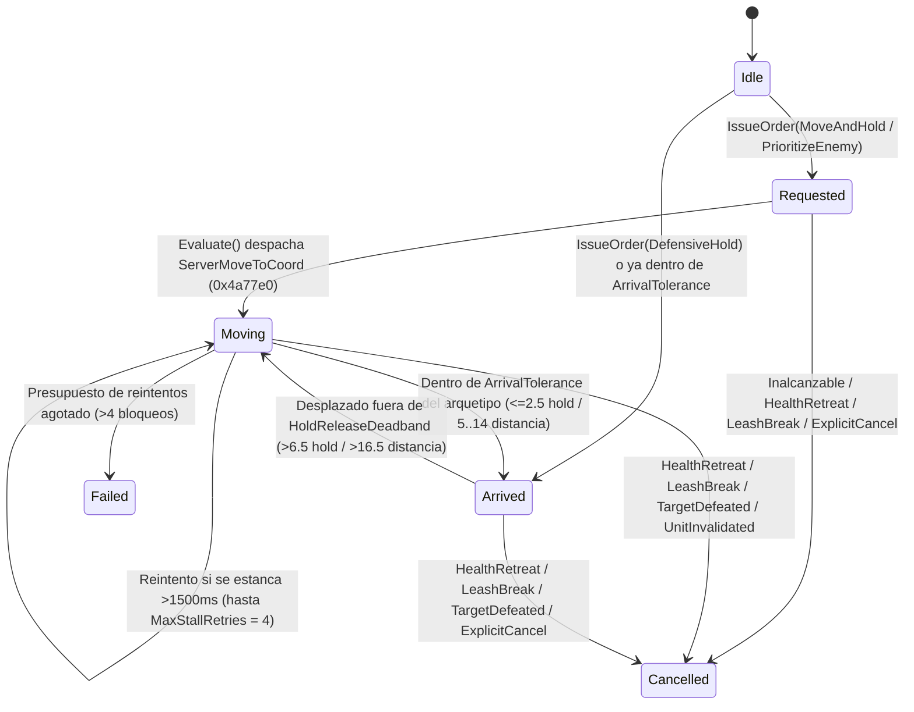

# IA de Compañero en VR: Órdenes Tácticas Basadas en Gestos (Apuntar, Priorizar, Mantener Posición y Reagrupar)

> English: [docs/VR_COMPANION_TACTICAL_COMMANDS.md](../VR_COMPANION_TACTICAL_COMMANDS.md) | Arquitectura General de IA: [docs/es/VR_COMPANION_AI.md](VR_COMPANION_AI.md)

## 1. Visión General y Motivación

En *Diablo II: Resurrected* de escritorio, el jugador no dispone de ningún mecanismo directo para ordenar a su mercenario que avance hasta una puerta, mantenga una posición defensiva o concentre sus ataques en un chamán o jefe peligroso manteniendo una distancia segura.

En Realidad Virtual (VR), `d2r-pcvr` permite dar órdenes tácticas naturales mediante gestos de mano a través de la **Máquina de Estados Explícita de Órdenes Tácticas** (`TacticalOrderController` en [`steamvr/companion_ai.h`](../../steamvr/companion_ai.h) y [`vr/companion_ai.cpp`](../../vr/companion_ai.cpp)):
- **Avanzar y Mantener Posición (`MoveAndHold`):** Apunta con tu mano a un punto del suelo y pulsa **Grip (Agarre)** para ordenar al mercenario que camine hasta esa coordenada y mantenga la posición sin oscilar ni regresar hacia ti.
- **Priorizar Enemigo (`PrioritizeEnemy`):** Apunta directamente a un monstruo hostil y pulsa **Grip** para concentrar el ataque sobre ese objetivo respetando el arquetipo del mercenario (`MeleeVanguard` cierra a cuerpo a cuerpo; `RangedOverwatch` ataca desde una ventana óptima de `10.0` sub-casillas).
- **Mantener Posición Defensiva (`DefensiveHold`):** Levanta la palma abierta hacia delante durante `400 ms` para fijar inmediatamente al mercenario en su posición actual como torreta o vanguardia defensiva.
- **Reagrupar / Cancelar Orden (`ExplicitCancel`):** Mientras una orden esté activa, apunta directamente al propio mercenario (`<= 2.5` sub-casillas) y pulsa **Grip** para cancelar la orden y volver al seguimiento normal en formación.

---

## 2. Máquina de Estados Explícita y Ciclo de Vida

Toda orden táctica evoluciona de forma determinista a través de `TacticalCommandState` y registra cada transición en `d2r-vr-frame.log` (`LogTacticalTransition`):

### Motivos de Cancelación (`TacticalCommandCancelReason`)
- `None`: Orden activa o en reposo (`Idle`).
- `Superseded`: Reemplazada por una nueva orden táctica del jugador.
- `ExplicitCancel`: El jugador apuntó al mercenario + Grip para reagruparlo.
- `HealthRetreat`: La salud del mercenario bajó del `50%` (`CriticalHealthRatio = 0.50f`); la supervivencia tiene prioridad absoluta.
- `LeashBreak`: El jugador o el mercenario superaron la correa elástica máxima (`ElasticCombatLeashDistance = 40.0` sub-casillas / ~16m).
- `TargetDefeated`: El monstruo marcado con `PrioritizeEnemy` murió (`animMode == 0 || animMode == 12`) o desapareció.
- `DestinationUnreachable`: La coordenada de destino no superó la validación de sala caminable `RoomPoint` (`0x38dfb0`).
- `StalledNoProgress`: El mercenario avanzó `< 1.0` sub-casilla durante `4` ventanas consecutivas de `1500 ms`.
- `UnitInvalidated` / `LevelTransition`: El mercenario murió, fue sustituido o el jugador cambió de nivel/sala.

---

## 3. Comportamiento por Arquetipo y Arquitectura Anti-Oscilación

El análisis en vivo sobre `D2R.exe 3.3.93847` reveló que la rutina nativa `AITHINK_Fn061_Hireable` (`0x5c1610`) provoca dos conflictos graves si no se arbitra por arquetipo y mediante compuertas de locomoción de bajo nivel:
1. **Conflicto de Huida de Pánico en Mercenarios a Distancia:** Si se ordena a una Arpía del Acto 1 (`271`) o a un Lobo de Hierro del Acto 3 (`359`) caminar hasta la coordenada exacta de un enemigo (`dist < 4` sub-casillas), `AITHINK_Fn061_Hireable` activa una huida de pánico hacia el jugador.
2. **Doble Ruta de Movimiento Nativo y Distracción por Objetivos Lejanos:** Aunque se intercepte `ServerMoveUnit` (`0x4a8a10`), `AITHINK_Fn061_Hireable` también llama a `0x4a87e0` (`0x4a88fd -> 0x4475c0 -> 0x445cc0/0x445db0`) para regresar junto al jugador en cuanto entra en `MONMODE_NEUTRAL (1)`, y `melee::Target` (`0x48fe20`) selecciona monstruos a hasta `48` sub-casillas.

### 3.1. Tolerancias por Arquetipo (`TacticalOrderController::GetOrderTolerances`)

| Tipo de Orden y Arquetipo | `minDist` | `arrivalTol` | `releaseDeadband` | Destino Efectivo de Marcha (`ComputeEffectiveMoveTarget`) |
| :--- | :--- | :--- | :--- | :--- |
| **`MoveAndHold` / `DefensiveHold` (Todos)** | `0.0` | `2.5` sub-casillas | `6.5` sub-casillas | Coordenada exacta del suelo `order.targetPos`. |
| **`PrioritizeEnemy` (`MeleeVanguard`)** | `0.0` | `3.5` sub-casillas | `7.5` sub-casillas | Coordenada del monstruo `order.targetPos`. |
| **`PrioritizeEnemy` (`RangedOverwatch`)** | `5.0` sub-casillas | `14.0` sub-casillas | `16.5` sub-casillas | Punto de tiro a distancia óptima (`RangedOptimalStandOff = 10.0` sub-casillas del monstruo). |

### 3.2. Bloqueo Sincronizado de Locomoción y Objetivos al Mantener Posición
1. **En tránsito (`Moving`) hacia `MoveAndHold`:**
   - `TryOverrideCombatTarget` (`0x48fe20`) devuelve `outTarget = 0` (`true`), impidiendo que el mercenario se distraiga con monstruos intermedios antes de llegar a la posición ordenada.
   - `DetourServerStartWalk` (`0x445cc0`) y `DetourServerStartRun` (`0x445db0`) rechazan (`return 0`) cualquier intento de la IA nativa de caminar hacia otro punto y fuerzan el re-despacho inmediato en el siguiente fotograma si la marcha fue interrumpida.
2. **Al llegar (`Arrived`) en `MoveAndHold` o `DefensiveHold`:**
   - `DetourServerMoveUnit` (`0x4a8a10`), `DetourServerStartWalk` (`0x445cc0`) y `DetourServerStartRun` (`0x445db0`) bloquean todos los intentos nativos de volver hacia el jugador o huir (`return 0` en `0x445cc0`/`0x445db0`, lo que hace que `0x4475c0` limpie el camino mediante `0x34f430` y mantenga al mercenario en `MONMODE_NEUTRAL (1)`).
   - `FilterNativeCombatTarget` (`0x48fe20`) filtra los candidatos de ataque nativos para que `MeleeVanguard` solo ataque monstruos a `<= 6.0` sub-casillas del punto de guardia (dentro del margen `HoldReleaseDeadband = 6.5`), y `RangedOverwatch` dispare sin moverse de su sitio a enemigos dentro de `24.0` sub-casillas.

---

## 4. Reconocimiento y Desambiguación de Gestos (`steamvr/transport.cpp`)

### 4.1. Señalar Primero al Mercenario: Mantener Grip, Apuntar y Soltar (`Pinchar y Arrastrar Táctico`)
Para eliminar por completo los falsos positivos al usar el botón `Grip` en otras acciones del juego (coger pociones del cinturón, desenfundar armas o interactuar con el entorno), toda orden táctica por `Grip` **debe iniciarse señalando primero al mercenario**:
- **Paso 1 — Enganchar al Mercenario (`Pulsar y Mantener Grip` sobre el mercenario):**
  - Se evalúa mediante intersección 3D con el cilindro vertical del cuerpo del mercenario (`hitsUnitCylinder3D` en coordenadas `coordinates::RenderGround`, radio `0.95m`, altura `[-0.45m, 2.00m]`) o radio en el suelo junto a sus pies (`<= 3.5` sub-casillas).
  - Si pulsas `Grip` apuntando a cualquier otro lugar sin haber señalado antes al mercenario, el sistema táctico lo ignora por completo.
  - Al enganchar al mercenario se emite un pulso háptico corto (`0.30f`) y se muestra un anillo dorado/verde (`color = 2`) bajo sus pies.
- **Paso 2 — Previsualización en Vivo (`Manteniendo Grip`):**
  - Mientras mantienes `Grip` apretado y mueves la mano hacia el objetivo:
    - Si apuntas al cuerpo o pies de un **monstruo hostil** (cilindro 3D de `0.85m` o radio en suelo de `2.5` sub-casillas), se previsualiza un **anillo rojo** (`color = 1`) sobre el enemigo.
    - Si apuntas a un punto del **suelo**, se previsualiza un **anillo cian** (`color = 3`) en `{ gx, gy }`.
    - Si mantienes el puntero sobre el **mercenario**, permanece el **anillo dorado/verde** (`color = 2`) sobre él.
- **Paso 3 — Ejecución al Soltar (`Soltar Grip`):**
  1. **Enemigo Hostil (`PrioritizeEnemy`):** Soltar `Grip` sobre un monstruo ordena `PrioritizeEnemy` sobre esa unidad.
  2. **Alternar sobre el Mercenario (`DefensiveHold` / `Regroup`):** Soltar `Grip` manteniendo el puntero sobre el propio mercenario (o tras un clic rápido `<= 300 ms`) alterna su estado:
     - Si tenía una orden activa (`Requested`, `Moving` o `Arrived`): ejecuta `CancelTacticalOrder()` (`Regroup`) y despacha inmediatamente una caminata de servidor (`DispatchServerMoveToCoord`) de regreso al flanco del jugador.
     - Si te estaba siguiendo normalmente (`Idle` / `Cancelled`): activa `DefensiveHold` clavándolo en su posición actual.
  3. **Coordenada del Suelo (`MoveAndHold`):** Soltar `Grip` apuntando al suelo emite `MoveAndHold` hacia `{ gx, gy }`. Si el pathfinder A* se detiene junto a un muro u obstáculo dentro de `NearObstacleArrivalTolerance` (`4.5` sub-casillas), el mercenario adopta esa posición como `Arrived` en lugar de dar error por atasco.

### 4.2. Palma Abierta para Mantener Posición (`DefensiveHold` tras `400 ms`)
- **Filtro Cinemático:** Mano abierta (`grip < 0.2f && trigger < 0.2f`), dedos apuntando hacia arriba (`handUp.y > 0.82f`) y normal de la palma alineada con la vista del jugador (`dot > 0.70f`) mantenida durante `400 ms`.
- **Acción:** Emite `DefensiveHold` anclado en la coordenada actual del mercenario (`compPos`).

---

## 5. Voces por Arquetipo y Configuración

| Evento Táctico | `TacticalVoiceCue` | Arpía Acto 1 (`271`) | Guardia Acto 2 (`338`) | Lobo de Hierro Acto 3 (`359`) | Bárbaro Acto 5 (`560`/`561`) |
| :--- | :--- | :--- | :--- | :--- | :--- |
| **`MoveAndHold` Aceptado** | `MoveConfirm` | `4294` / `4291` | `3952` | `4040` / `4041` | `4565` |
| **`PrioritizeEnemy` Aceptado** | `AttackConfirm` | `2949` / `2950` | `3183` / `3184` | `3105` / `3106` | `3027` / `3028` |
| **`DefensiveHold` Aceptado** | `HoldConfirm` | `2943` / `2944` | `3177` / `3178` | `3099` / `3100` | `3021` / `3022` |
| **Orden Rechazada / Fallida** | `Impossible` | `2953` / `2954` | `3187` / `3188` | `3109` / `3110` | `3031` / `3032` |
| **Ruptura de Correa (40)** | `RegroupLeash` | `2939` / `2940` | `3173` / `3174` | `3095` / `3096` | `3017` / `3018` |
| **Salud Crítica (`< 50%`)** | `Distress` | `2937` / `2938` | `3171` / `3172` | `3093` / `3094` | `3015` / `3016` |

- **Ajuste en INI:** `[gameplay] companion_tactical_commands=1` en `d2r_pcvr.ini` (también configurable en vivo desde el menú VR en **Combat -> Tactical Commands**).

